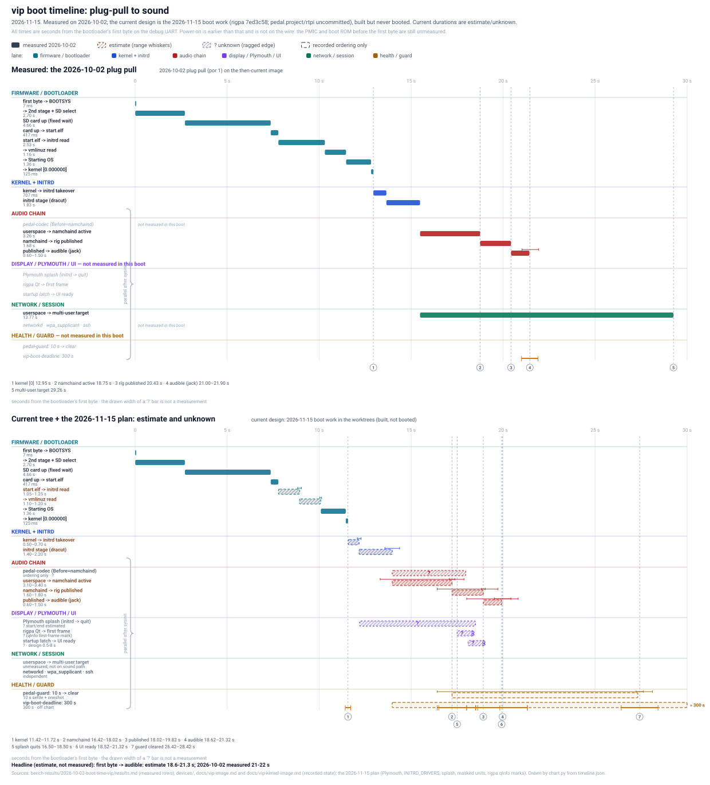
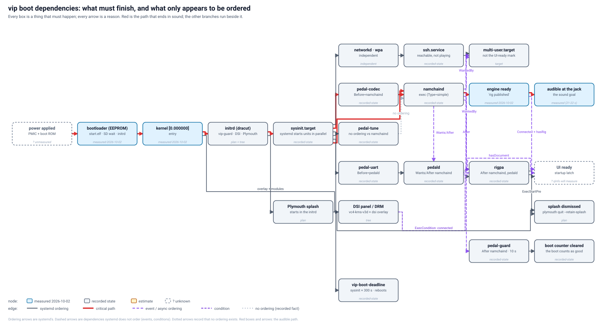

# vip's boot timeline: plug-pull to sound

**2026-11-15.** What is measured about vip's boot, what the current tree and the 2026-11-15 boot work
are expected to do, and exactly what to run on the next boot to turn every estimate into a
measurement.

**Read this first.** The **new root was booted and measured on vip on 2026-11-15**, but the
initrd boot splash and Plymouth were both tried and rejected: the DSI/DRM initramfs stopped the SD
root from appearing, and `plymouthd` SIGSEGVs on the panel's DSI stack. What covers the screen is
**rigpa's own Startup splash**, measured below. The "current design" column is the plan as it
stood before that boot; "Outcome on vip" says what actually shipped, and the live-capture section
has the numbers. Charts: solid = measured, hatched = estimate, ragged with `?` = unknown, dashed
= an ordering that is recorded but not timed.

The 2026-11-15 boot work is in these `deepseek-boot` worktrees: rigpa's splash and startup gate
are commit `ea73e5` on branch `deepseek/boot-and-ui`, and the `pedal.project` and `rtpi` sides are
`5b73bc3` and `de874cf` on the same branch, and the root was booted on 2026-11-15. The DSI/Plymouth
boot splash was tried and rejected; the startup gate is what shipped and was measured (Outcome on
vip). The design rows below are kept as the plan that the boot tested, not as the shipped shape.





## The headline

- **Measured, 2026-10-02 plug pull:** the bootloader's first byte on the debug UART to audible
  sound is **21–22 s**; 12.95 s of that is firmware and bootloader (including a fixed 4.66 s SD
  wait and a 2.2 s read of a 52.8 MB initrd), and 8.05–8.95 s is the kernel, systemd and the
  engine, with `namchaind` active 5.80 s after the kernel's first line and the rig published
  7.48 s after it. [`results.md`](../2026-10-02-boot-time-vip/results.md).
- **Current design, estimate as planned:** **18.6–21.3 s** from the first byte to audible. The
  initrd slimming should remove about 1.4 s of the firmware's initrd read. The boot of 2026-11-15
  rejected the initrd DSI/Plymouth part (Outcome on vip), so this figure remains an estimate for
  the audio path, not a measured screen time.
- **Measured live, 2026-11-15, pre-splash root:** `systemd-analyze` reports **23.187 s** = 2.391
  kernel + 3.206 initrd + 17.589 userspace; `namchaind` starts at 10.906 s, `pedald` 10.931,
  `rigpa` 11.122. The old root's userspace tail is gated by `pedal-tune` (14.957 s, finishing at
  23.178) and `pedal-guard` (11.016 s), not by the engine or the UI. The screen is rigpa's
  placeholder from 11.1 s; the old rigpa logs no first-frame time.
- **Unknown:** the time from applying power to the bootloader's first byte (PMIC and boot ROM,
  still not on the wire). The new root's screen numbers are measured in Outcome on vip; the
  boot-to-*sound* total is still an estimate.

## Outcome on vip, 2026-11-15

The new root (pedal `c9b41a6`, rigpa `ea73e50`, namchain `d1aa45c`) boots on the box's DSI panel
and runs the engine, pedald and the UI. Three things were decided by the hardware, not the plan:

1. **The initramfs DSI/DRM stack does not boot.** With `vc4`, `drm-rp1-dsi`, `panel-simple`,
   `rpi-panel-attiny-regulator`, `backlight` and `i2c-brcmstb` in the initrd (for a Plymouth boot
   splash), the boot stopped at `sdhci-brcmstb 1001100000.mmc: error -EINVAL: invalid resource
   (null)` and never reached the root or ssh; the slot had to be abandoned after a power cycle.
   A storage-only initrd boots. `INITRD_DRIVERS` is storage-only again.
2. **`plymouthd` SIGSEGVs in userspace** on this DSI stack (`plymouth-start.service: Main process
   exited, code=killed, status=11/SEGV`), with both the scaled theme script and a static one. All
   three Plymouth units are masked and `splash` is off the command line. The theme remains in the
   tree, inert, for a future retry.
3. **rigpa's Startup splash is what shows**, and it was measured on the new root:

| | measured 2026-11-15, new root |
|---|---|
| kernel / initrd | 2.397 s / 2.092 s |
| `rigpa.service` active | 10.168 s (from kernel start) |
| `startup: scene built` | +1.797 s after rigpa starts |
| `startup: first frame` | +1.922 s — **the screen first shows the splash at ≈12.09 s** |
| `startup: ready` / dismissed | +2.422 / +2.423 s — **Play at ≈12.59 s** |
| `multi-user.target` | 34.989 s (the `pedal-tune` tail again) |

The screen is black from the kernel's first line to 12.09 s; from then it is the full-screen
rigpa splash for 501 ms, then Play. The firmware/bootloader time before the kernel is still only
the 2026-10-02 measurement. The new root's `getty@.service` is masked, so no login prompt paints
over the splash.

## The 2026-11-15 live capture (pre-splash root)

A live boot was captured at 01:19 UTC on the running root, with the debug probe attached: pedal
image `cb3292a`, namchain `d1aa45c`, rigpa `f32bb2a`, no Plymouth, and the `getty@tty1` login
prompt on the DSI panel. It is **not** the 2026-11-15 design; it is the baseline that design
replaces.

| | measured 2026-11-15 |
|---|---|
| `systemd-analyze` kernel | 2.391 s |
| `systemd-analyze` initrd | 3.206 s |
| `systemd-analyze` userspace | 17.589 s |
| **total** | **23.187 s** |
| `networkd` active | 7.190 s |
| `pedal-codec` start → exit | 8.202 → 10.514 s |
| `pedal-uart` start → exit | 8.222 → 8.950 s |
| `pedal-tune` start → exit | 8.218 → **23.178 s** (14.957 s; the multi-user gate) |
| `wpa_supplicant` → `ssh` | 9.666 → 9.843 s |
| `getty@tty1` | 9.801 s |
| `namchaind` | 10.906 s |
| `pedald` | 10.931 s |
| `rigpa` | 11.122 s |
| `pedal-guard` start → exit | 10.916 → 21.933 s (11.016 s) |
| `multi-user.target` | 23.182 s |

What this capture establishes:

- **The engine and the UI are up long before `multi-user.target`.** `namchaind` at 10.9 s,
  `pedald` at 10.9, `rigpa` at 11.1. The screen is rigpa's placeholder from then on; the 12 s to
  `multi-user.target` is `pedal-tune` and `pedal-guard`, not the screen or the audio path.
- **`pedal-tune` is the critical path's tail.** `systemd-analyze critical-chain` is
  `graphical.target → multi-user.target → pedal-tune.service @2.623s +14.957s`. The script itself
  finishes in under a second when run by hand; at boot it is the `systemctl set-property --runtime
  init.scope` call that waits while systemd is still bringing units up. That is the one obvious
  boot-time optimisation left, and it is **not** in this change.
- **The 2026-10-02 kernel/initrd split is stale.** This boot reports 2.391 s kernel and 3.206 s
  initrd, against 0.707 and 1.830 then. The firmware numbers (first byte → kernel) still come only
  from the 2026-10-02 wire capture.
- **Wall-clock unit timestamps are not trustworthy on this board.** The NTP correction after boot
  jumped the clock by about 1 h 50 m, so `who -b` and the units' "since" lines say 23:29 while
  `/proc/uptime` and the monotonic stamps say the boot was minutes old. Use only the monotonic
  stamps (as this table does).
- **The old rigpa cannot say when it first painted.** The new design's `startup: first frame`
  marker is exactly what fills that gap on the next boot.

## What this page is, and what it is not

- It **is** the measured plug-pull stage table, with the current tree's ordering facts read from
  its unit files and image pins, and the 2026-11-15 plan's boot changes written in as the design
  of record.
- It is **not** a measurement of the current image. No duration in the current column was
  observed; the four authority labels say what each number rests on.
- It **recorded** the 2026-11-15 boot of the new root: the initrd splash and Plymouth were
  rejected by the hardware, and rigpa's startup splash was measured (Outcome on vip). The design
  rows remain the plan that boot tested.
- It is **not** a power-on number. The anchor is the bootloader's first byte; power applied is
  earlier by however long the PMIC and boot ROM take, and that has never been measured.

## Authority: how to read every number

| Label | Means |
|---|---|
| `measured-2026-10-02` | Observed on vip's plug-pull boot of 2026-10-02: the serial wire (`tools/measure-boot.py` and the probe), vip's own `dmesg`/journal, `systemd-analyze`, and the same boot's jack-end run (`tools/measure-audio.py`). Source: [`results.md`](../2026-10-02-boot-time-vip/results.md), [`jack/README.md`](../2026-10-02-boot-time-vip/jack/README.md). |
| `recorded-state` | Read from the recorded configuration: unit ordering, `vip-boot`, `device.env`, `config-pedal.txt`, the image lock, and the 2026-11-15 boot work in the worktrees. It says what must happen and in what order, never how long it takes. |
| `estimate` | Derived from a measurement with the arithmetic shown under [How the estimates were made](#how-the-estimates-were-made), or bounded by the design. Not measured on the current image. |
| `unknown` | Not measured and not derivable. In the chart a `?` marks it, and the bar's drawn width is a layout decision, not a measurement. |

A stage that is marked `recorded-state` and has a vertical window in the chart (for example
`pedal-codec`) is an **ordering window**: the unit must run between two known things; its own
duration is unknown.

## Method and sources

1. **The measured half.** The 2026-10-02 work is reused rather than redone: the Pi's bootloader
   logs on the debug UART (`BOOT_UART=1`), and the same boot's kernel console, journal and
   `systemd-analyze` were captured with a real USB-C plug pull (`power-on-reset 1`), plus a
   simultaneous 220 Hz tone through the pedal analysed on the Mac. The stage timings, the kernel
   split and the audible time on this page are that boot's.
2. **The current tree's facts.** Read in this checkout: the unit files and drop-ins under
   `devices/common/rootfs/etc/systemd/system/` and `devices/vip/rootfs/`, `devices/vip/device.env`
   (from rtpi), `devices/vip/config-pedal.txt`, `devices/vip/image.lock`,
   [`docs/vip-image.md`](../../docs/vip-image.md) and
   [`docs/vip-kernel-image.md`](../../docs/vip-kernel-image.md) (the measured initrd/vmlinuz
   sizes of 2026-10-05), and the rigpa base unit and drop-ins.
3. **The 2026-11-15 boot work (built in the worktrees, unmeasured).** The plan entry in
   [`plan.md`](../../plan.md) ("Boot splash, metering and the footswitch's release-press"),
   [`docs/vip-image.md`](../../docs/vip-image.md) ("The boot splash"),
   [`docs/vip-kernel-image.md`](../../docs/vip-kernel-image.md) (the larger initrd), and the files:
   `devices/common/rootfs/etc/plymouth/` and
   `devices/common/rootfs/usr/share/plymouth/themes/pedal/` (theme and `plymouthd.conf`),
   `devices/vip/packages` (Plymouth), `devices/common/image/build-image` and rtpi's
   `vip-install-kernel`/`device.env` (`INITRD_DRIVERS`; `splash plymouth.ignore-serial-consoles
   vt.global_cursor_default=0` in `BASE_ARGS`), `devices/vip/rootfs/etc/pedal/masked-units`
   (`plymouth-quit`, `plymouth-quit-wait`, `getty@tty1`), the rigpa drop-in's
   `ExecStartPre=-/usr/bin/plymouth quit --retain-splash`,
   `devices/common/rootfs/etc/systemd/system/pedal-splash-quit.service` (the loose profile), and
   rigpa's `Startup` gate with its qInfo marks ("startup: scene built / first frame / engine /
   document / ready / dismissed / gave up"). These are the design of record, with no duration
   attributed to them.

**Not done because the hardware is not reachable:** no probe capture, no current `journalctl`,
no `systemd-analyze`, no screen observation, and no jack measurement. `collect.sh` exists to take
the reachable half of that on the next boot; see [Replacing the estimates](#replacing-the-estimates-on-the-next-vip-boot).

## The stage table

Times are seconds from the bootloader's first byte unless stated. "Current" is the design of
record; the authority column is the authority of the **current** number. The `2026-10-02` column
is measured and is what makes the current one arguable rather than invented.

| # | Lane | Stage | 2026-10-02 measured | Current (2026-11-15) | Authority | Why / source |
|---|---|---|---|---|---|---|
| 1 | firmware | power applied → first byte | — | — | `unknown` | PMIC and boot ROM before the bootloader prints. Not on the wire, so not observable by this method. |
| 2 | firmware | first byte → `BOOTSYS release` | 0.007 s | ≈0.007 s | `measured-2026-10-02` | Measured on the factory `2026-05-11` EEPROM. vip's EEPROM has run the 2026-09-25 image since 2026-10-07 ([`docs/vip-image.md`](../../docs/vip-image.md), "The bootloader EEPROM"), so every firmware row below is really ±0.1 s until re-measured with the probe. |
| 3 | firmware | `BOOTSYS` → second-stage bootloader + `Boot mode: SD` | 2.697 s | ≈2.697 s | `measured-2026-10-02` | Cumulative lines at 2.474 s (`BOOTLOADER release`) and 2.704 s (boot mode). Same EEPROM caveat. |
| 4 | firmware | SD select → SD card up at 400 kHz | **4.664 s** | ≈4.664 s | `measured-2026-10-02` | 4.666, 4.664 and 4.664 s across three boots of two kinds: a fixed bootloader wait, not contention. The largest single wait; Phase 4's target, not this change's. |
| 5 | firmware | card up → `start.elf` `Restart logging` | 0.417 s | ≈0.417 s | `measured-2026-10-02` | 7.368 s → 7.785 s. Part of the firmware's card handling; not the initrd read. |
| 6 | firmware | `start.elf` → initrd read complete | 2.526 s | **1.05–1.25 s** (≈0.82 s read + the measured 0.33 s overhead) | `estimate` | 2026-10-02: 52.8 MB in 2.2 s ≈ 24 MB/s. The current initrd is ~19.75 MB (the last measured initrd was **19 MB** on 2026-10-05 for the trimmed kernel, [`docs/vip-kernel-image.md`](../../docs/vip-kernel-image.md); the plan adds DSI/DRM modules and Plymouth). Scaling the read, not the overhead: 0.326 + 19.75/24 ≈ **1.15 s**. The ±10% is for SD/card variation and the newer bootloader. |
| 7 | firmware | initrd complete → vmlinuz read complete | 1.156 s | 1.10–1.20 s | `estimate` | 2026-10-02: 14.7 MB in 0.6 s plus ~0.56 s overhead. The trimmed vmlinuz is 14 MB (2026-10-05), so the read shrinks by ~30 ms: no real change. |
| 8 | firmware | vmlinuz complete → `Starting OS` | 1.358 s | ≈1.358 s | `measured-2026-10-02` | Bootloader handover of kernel, device tree and command line; nothing in the current change touches it. Same EEPROM caveat. |
| 9 | firmware | `Starting OS` → kernel `[0.000000]` | 0.125 s | ≈0.125 s | `measured-2026-10-02` | The kernel's first line on the wire. |
| — | firmware | **first byte → kernel** | **12.950 s** | **≈11.4–11.7 s** | `estimate` | Sum of rows 2–9; only row 6 (and marginally row 7) moves. |
| 10 | kernel | kernel → initrd takeover | 0.707 s | 0.50–0.70 s | `estimate` | `systemd-analyze`'s "kernel" on 2026-10-02. Less initrd to unpack now, by an unmeasured amount. |
| 11 | kernel | initrd stage (dracut) | 1.830 s | **1.4–2.2 s** | `estimate` | `systemd-analyze`'s "initrd" on 2026-10-02. The plan's initrd is smaller but must load DRM/DSI/panel modules and start Plymouth; the two effects oppose and neither side is measured, so the range is wide and the direction is deliberately not asserted. |
| 12 | audio | `pedal-codec` (`Before=namchaind`) | — | ordering only; duration `?` | `recorded-state` | [`pedal-codec.service`](../../devices/common/rootfs/etc/systemd/system/pedal-codec.service) is a oneshot loading the WM8960 overlay and mixer, ordered `Before=namchaind.service`. Its window is the userspace-to-namchaind estimate; its own duration has never been recorded. |
| 13 | audio | userspace start → `namchaind` active | 3.263 s | 3.10–3.40 s | `estimate` | Measured: 5.80 s from kernel minus 0.707 s kernel and 1.830 s initrd = 3.263 s. Same root mount / systemd / codec path, so the measured figure carries; only its absolute start moves with row 11. |
| 14 | audio | `namchaind` → rig published | 1.68 s | 1.60–1.80 s | `estimate` | Measured: 7.48 s to "rig published" minus 5.80 s to namchaind = 1.68 s. The engine path is unchanged in this tree (engine, rig and codec open). |
| 15 | audio | rig published → audible at the jack | 0.6–1.5 s | 0.6–1.5 s | `estimate` | The jack run put "published" at kernel+8.179 s and the tone crossing the gate 0.73 s later (first detectable 0.17 s *before* "published"); the fixture's 100 µF cap smears both ends by about a second. "Playing" and "audible" are the same moment to within the method's second. Analogue path unchanged, so the measured bound carries. |
| — | audio | **first byte → audible** | **21.0–21.9 s** | **≈18.6–21.3 s** | `estimate` | 11.4–11.7 s (firmware) + 0.5–0.7 + 1.4–2.2 + 3.1–3.4 + 1.6–1.8 + 0.6–1.5. See the arithmetic below. |
| 16 | display | Plymouth splash, from the initrd to rigpa's `ExecStartPre` | — | starts ≈12.2–12.8 s; ends at rigpa start ≈16.6–18.5 s; duration `?` | `unknown` | Plymouth (`devices/vip/packages`) with the `pedal` theme and `ShowDelay=0`/`DeviceTimeout=8`, the DSI stack in the initrd via `INITRD_DRIVERS`, and `splash plymouth.ignore-serial-consoles vt.global_cursor_default=0` in `BASE_ARGS`. Both ends are derived from rows 6–11 and 18; nothing about Plymouth has been timed on this hardware. |
| 17 | display | rigpa Qt start → first frame | — | `?` | `unknown` | Qt eglfs on the DSI device, QML scene load, first frame. rigpa's startup gate logs exactly this: `startup: scene built at N ms`, `startup: first frame at N ms`, then `startup: engine`, `startup: document`, `startup: ready` and `startup: dismissed at N ms (ready)` (rigpa `src/app/Startup.cpp`, commit `ea73e5`). Those journal lines replace this row. |
| 18 | display | startup latch → UI ready | — | `?`; bounded below at 500 ms and above at 8 s, plus a 200 ms fade; estimate ≈18.5–21.3 s absolute, hard cap ≈24.5–26.5 s | `unknown` | rigpa's `Startup` gate (commit `ea73e5`) holds its splash until `EngineSession` is Connected with a rig and `RigSession` has the document, min 500 ms from the first frame and max 8 s; then a 200 ms fade. The bounds are the code's; the actual value is unmeasured, and the 8 s cap is an absolute ceiling relative to rigpa's start (≈24.5–26.5 s from the first byte), not a typical value. |
| 19 | display | splash dismissed | — | at rigpa's `ExecStartPre`, ≈16.6–18.5 s | `recorded-state` | rigpa's drop-in runs `ExecStartPre=-/usr/bin/plymouth quit --retain-splash`; `--retain-splash` leaves the last splash frame on the DRM output until Qt draws. `getty@tty1`, `plymouth-quit` and `plymouth-quit-wait` are masked so nothing else dismisses it on a tuned boot; the loose profile uses `pedal-splash-quit.service`. |
| 20 | network | userspace start → `multi-user.target` | **13.774 s** userspace = 16.311 s after the kernel = 29.26 s from the first byte | `unknown` | `unknown` | The old image's target completed 8.8 s after the engine had published; the record does not name the unit that held it (WiFi association is a candidate, not a finding). The current tree makes the network independent of the pedal's health, and the target is not an audible or UI-ready proxy — see "What is not a dependency". `collect.sh` captures `systemd-analyze blame` and `critical-chain` to settle it. |
| 21 | network | networkd · wpa_supplicant · ssh | — | independent; no duration | `recorded-state` | No ordering into the audio path. `pedal-guard` requires `namchaind` only ("not the network, which a pedal at a gig doesn't have"), and the tuned profile does not wait on `network-online.target`. |
| 22 | health | `pedal-guard`: 10 s stable after namchaind → boot counter cleared | — | ≈26.5–28.4 s (namchaind + 10 s settle + oneshot) | `recorded-state` | `pedal-guard.service` is `After=namchaind.service` and runs `vip-boot guard-clear --require-unit namchaind.service --wait 120`; `vip-boot`'s default `--settle` is 10 s (rtpi `devices/vip/usr/local/sbin/vip-boot`). The 10 s is by design; its absolute placement is derived from the estimates above. Not on the sound path. |
| 23 | health | `vip-boot-deadline` | — | sysinit + 300 s | `recorded-state` | `vip-boot-deadline.service` is `WantedBy=sysinit.target`, `DefaultDependencies=no`, ordered after nothing, and runs `vip-boot deadline --after 300`; it reboots a pedal boot that never reached `pedal-guard`. It holds nothing up. |
| 24 | display | Plymouth in the initrd and on the command line | — | configuration only, no duration | `recorded-state` | rtpi's `device.env` sets `INITRD_DRIVERS="sdhci-brcmstb sdhci-iproc mmc_block ext4 vfat vc4 drm-rp1-dsi panel-simple rpi-panel-attiny-regulator backlight i2c-brcmstb"`, read by both `vip-install-kernel` and [`build-image`](../../devices/common/image/build-image), whose build **fails** if the pedal kernel's `lsinitrd` lacks `plymouthd`, the theme or `vc4`. `BASE_ARGS` adds `splash plymouth.ignore-serial-consoles vt.global_cursor_default=0` (no `quiet`). Uncommitted working-tree changes at the time of writing. |
| 25 | display | rigpa startup qInfo marks | — | measurement instrument, no duration | `recorded-state` | rigpa commit `ea73e5` on `deepseek/boot-and-ui`: `Startup` logs `startup: scene built`, `first frame`, `engine`, `document`, `ready`, plus `dismissed`/`gave up`, each `at N ms` on rigpa's own clock. |
| 26 | everything | the 2026-10-02 boot's own limits | method accuracy ≈0.1 s | — | `measured-2026-10-02` | The wire's own cost is 0.12–0.13 s (115200 serial plus the 10 ms read cycle), the firmware's clock agrees with the wire's, and the jack end is good to about a second because of the fixture's capacitor. |

### Configuration facts behind the ordering

These are the recorded-state facts the dependency graph is built from. They are committed on `deepseek/boot-and-ui`: rigpa `ea73e5`, pedal.project `5b73bc3`,
rtpi `de874cf`.

| Fact | Where |
|---|---|
| `pedal-codec` runs before `namchaind` | [`pedal-codec.service`](../../devices/common/rootfs/etc/systemd/system/pedal-codec.service): `Before=namchaind.service` |
| `pedal-uart` runs before `pedald` | [`pedal-uart.service`](../../devices/common/rootfs/etc/systemd/system/pedal-uart.service): `Before=pedald.service` |
| `pedald` wants and follows `namchaind`, and never holds it up | [`pedald.service`](../../devices/common/rootfs/etc/systemd/system/pedald.service): `Wants=namchaind.service`, `After=namchaind.service` |
| `rigpa` follows both and needs a connected screen | [`10-pedal.conf`](../../devices/common/rootfs/etc/systemd/system/rigpa.service.d/10-pedal.conf): `After` comes from rigpa's own unit; the drop-in's `ExecCondition` greps `connected` from `card*-HDMI-A-*/status` and `card*-DSI-*/status`; [`80-rigpa-screen.rules`](../../devices/common/rootfs/etc/udev/rules.d/80-rigpa-screen.rules) starts it on a DRM hotplug, so a panel that appears after the boot check is still picked up |
| vip's DSI panel is enabled in the boot partition, and rigpa points at its stable DRM path | [`config-pedal.txt`](../../devices/vip/config-pedal.txt): `dtoverlay=vc4-kms-v3d` and `dtoverlay=vc4-kms-dsi-waveshare-800x480`; [`kms.json`](../../devices/vip/rootfs/etc/rigpa/kms.json): `platform-1f00130000.dsi-card` |
| rigpa's full ordering and limits | rigpa's own `packaging/systemd/rigpa.service`: `After=namchaind.service pedald.service`; the drop-ins add the condition, `CPUAffinity=0`, `MemoryMax=256M`, `OOMScoreAdjust=500` (D14: a screen is the first thing to lose under memory pressure) |
| `pedal-guard` follows `namchaind` and requires it to stay up | `pedal-guard.service` (rtpi `devices/vip/etc/systemd/system/`): `After=namchaind.service`, `ConditionKernelCommandLine=vipboot.root=pedal`, `vip-boot guard-clear --require-unit namchaind.service --wait 120`; `--settle` defaults to 10 s |
| `vip-boot-deadline` is armed at sysinit and ordered after nothing | `vip-boot-deadline.service` (rtpi): `WantedBy=sysinit.target`, `DefaultDependencies=no`, `vip-boot deadline --after 300` |
| the network is not part of the pedal's health | `pedal-guard.service`'s comment and condition (namchaind only); `pedal-maint.target` wants the network only in the loose profile; nothing on the tuned path waits for `network-online.target` |
| `pedal-tune` has **no** ordering against `namchaind` | [`pedal-tune.service`](../../devices/common/rootfs/etc/systemd/system/pedal-tune.service): `After=sysinit.target systemd-udevd.service` only, so it runs beside the engine |
| `pedal-maint.target` is the loose profile and is not the boot path | [`pedal-maint.target`](../../devices/vip/rootfs/etc/systemd/system/pedal-maint.target) |
| Plymouth is installed and themed | `devices/vip/packages` adds `plymouth`; `devices/common/rootfs/etc/plymouth/plymouthd.conf` sets `Theme=pedal`, `ShowDelay=0`, `DeviceTimeout=8`; the theme is `devices/common/rootfs/usr/share/plymouth/themes/pedal/` |
| the initrd carries the DSI/panel KMS stack and Plymouth | rtpi `device.env`: `INITRD_DRIVERS` (storage plus `vc4 drm-rp1-dsi panel-simple rpi-panel-attiny-regulator backlight i2c-brcmstb`); read by `vip-install-kernel` and `build-image`; `build-image` fails the build if `plymouthd`, the theme or `vc4` is absent from the pedal kernel's initrd |
| `splash` is on the command line | rtpi `device.env`: `BASE_ARGS` gains `splash plymouth.ignore-serial-consoles vt.global_cursor_default=0`; deliberately **no `quiet`** |
| nothing else dismisses the splash on a tuned boot | [`masked-units`](../../devices/vip/rootfs/etc/pedal/masked-units) masks `plymouth-quit.service`, `plymouth-quit-wait.service` and `getty@tty1.service`; rigpa's drop-in has `ExecStartPre=-/usr/bin/plymouth quit --retain-splash`; the loose profile uses [`pedal-splash-quit.service`](../../devices/common/rootfs/etc/systemd/system/pedal-splash-quit.service) |
| rigpa logs its startup timings | rigpa `src/app/Startup.{h,cpp}`, commit `ea73e5`; `qInfo` lines `startup: scene built at N ms` … `startup: dismissed at N ms (ready)` |

## In parallel, and in sequence

### The serial half: nothing overlaps the firmware

The firmware and bootloader are strictly serial: boot ROM, first-stage bootloader, the fixed
**4.664 s** SD wait, the initrd read, the vmlinuz read, `Starting OS`, the kernel's first line.
The current change attacks exactly one of these: the initrd read, by shrinking 52.8 MB to
~19.75 MB. It does **not** touch the 4.664 s SD wait, which is now by far the largest single
item in the boot (21% of the measured 21–22 s) and the item Phase 4 is for. Nothing in the
systemd part can start before the kernel does.

### After sysinit: four branches that must not be mistaken for one

systemd starts everything after `sysinit.target` with only the orderings recorded below. The
branches are:

1. **The audio chain (the critical path to sound):** `pedal-codec` → `namchaind` → the engine
   loads the rig and opens ALSA → the codec's DAC is running → `published` → audible. This is the
   path the boot-time number is about, and it is serial: each step must finish before the next
   can.
2. **Display / Plymouth / UI:** `namchaind` and `pedald` start first (rigpa is ordered after
   both), then rigpa's `ExecStartPre` dismisses Plymouth, Qt opens the DSI device and builds the
   scene, and the startup latch waits for the engine's `Connected` + rig and the pedal project's
   document before the splash gives way to the UI. The branch runs **beside** the audio chain: it
   starts as soon as namchaind has *exec'd*, not when the rig is ready, and its readiness point
   is after the engine's. It is not on the audible path.
3. **Network / session:** networkd, wpa_supplicant and ssh start in parallel and are independent
   of the pedal's health. On the 2026-10-02 image the target completed 8.8 s after the engine
   published; that tail is not identified, and it is deliberately no longer a health input.
4. **Health / guard:** `pedal-guard` starts after namchaind and then waits 10 s for it to stay
   up; `vip-boot-deadline` is armed at sysinit and run after nothing. Both are safeguards; neither
   gates sound, the UI or the session.

Two more facts are parallel rather than ordered: `pedal-tune` runs beside the engine (so the
audio tuning may be applied after the engine has started — see the caveats); and `getty@tty1` is
masked, so it is not in the picture at all, while Plymouth is — on the display branch.

### What depends on what finishing

- **Audible sound depends on:** the kernel reaching userspace; `pedal-codec` finishing;
  `namchaind` starting; the engine loading the rig and opening the codec. It does **not** depend
  on rigpa, pedald, the network, `pedal-guard` or `pedal-tune` finishing.
- **The splash being dismissed depends on:** rigpa's `ExecStartPre`, and so on the screen
  condition passing; not on Qt drawing its first frame (`--retain-splash` keeps the frame until
  Qt draws) and not on the startup latch.
- **UI ready depends on:** `EngineSession` `Connected` with a rig, `RigSession` having the
  document, the scene being built, and the latch's 500 ms minimum; its hard upper bound is the
  latch's 8 s, so a slow engine or document shows the splash for at most 8 s before the UI is
  shown anyway.
- **The boot counter clearing depends on:** `namchaind` staying active in one run for 10 s.
- **`multi-user.target` completion depends on:** every unit wanted by `multi-user.target` having
  **started** its main process; it is not a proxy for the engine being ready and certainly not for
  the UI being ready. On the 2026-10-02 boot it completed at 29.26 s from the first byte, 8.8 s
  after the engine was audible.
- **Nothing depends on the network** for any of the above, by design.

### The display path, in order

1. Plymouth starts in the initrd, once the DRM device is up (the plan's `INITRD_DRIVERS` set
   makes the DSI host, panel and backlight present there), and paints the splash.
2. The kernel's `vc4-kms-v3d` and `vc4-kms-dsi-waveshare-800x480` overlays (already in
   [`config-pedal.txt`](../../devices/vip/config-pedal.txt)) give the DSI connector.
3. `rigpa.service`'s `ExecCondition` checks that a connector says `connected`; if the panel is up,
   the unit runs, and its `ExecStartPre` runs `plymouth quit --retain-splash`.
4. Qt's eglfs opens `/dev/dri/by-path/platform-1f00130000.dsi-card` and draws the first frame;
   the retained splash frame is replaced when Qt paints.
5. The `Startup` latch keeps rigpa's own splash overlay up until engine + document are ready
   (min 500 ms, max 8 s), then a 200 ms fade gives the UI.
6. If the panel is **not** up when the condition is checked, rigpa is skipped and nothing
   dismisses Plymouth; the udev rule starts rigpa when the panel appears, the condition is
   re-checked, and the same `ExecStartPre` dismisses the splash then. If no screen is ever
   connected, nothing dismisses Plymouth — see the caveats.

## Caveats

1. **The initrd splash was tried and rejected; the startup splash was booted.** See Outcome on
   vip: the DSI/DRM initramfs stopped the root, `plymouthd` segfaulted, and rigpa's Startup
   splash is what shows (first frame 1.922 s after rigpa starts). The current-design column is
   the pre-boot plan; the live-capture section is the pre-splash root.
2. **The firmware measurements are on the factory EEPROM.** The 2026-10-02 boot ran the
   `2026-05-11` bootloader; vip's EEPROM has been `2026-09-25` since 2026-10-07. The bootloader's
   SD wait, initrd read and handover timings are not guaranteed identical; re-measure with the
   probe before quoting any firmware number as current.
3. **The initrd estimate assumes a linear SD read.** 24 MB/s is one measurement on one card. The
   arithmetic is shown; the range is ±10%, not a guarantee.
4. **The userspace tail was not identified.** 13.774 s userspace on 2026-10-02 is 8.8 s after the
   engine published; no `systemd-analyze blame` from that boot is in the record. Do not treat
   "multi-user.target" as "the pedal is up", and do not carry the 13.774 s figure into the
   current image.
5. **The 2026-11-15 work is built in the worktrees but has never booted.** rigpa is commit
   `ea73e5` on `deepseek/boot-and-ui`; the `pedal.project` and `rtpi` changes are `5b73bc3`
   and `de874cf`.
   when this page was written. If the implementation changes (for example the `INITRD_DRIVERS`
   names, or whether `quiet` is added alongside `splash`), rows 6, 11 and 16–19 move.
6. **`console=tty1` without `quiet`.** `BASE_ARGS` keeps `console=tty1` and adds
   `splash plymouth.ignore-serial-consoles vt.global_cursor_default=0` but **no `quiet`**, so the
   serial console keeps its diagnostics by design. Kernel messages on the framebuffer console can
   still paint over a Plymouth splash; if the first splash boot shows text over it, `quiet` is the
   knob. Masking `getty@tty1` removes the login prompt, not the console.
7. **No screen means no dismissal on a tuned boot.** `plymouth-quit`/`plymouth-quit-wait` are
   masked and the only quit is rigpa's `ExecStartPre`; if rigpa never passes its condition (panel
   never appears), Plymouth is never dismissed and the splash stays up. That is the documented
   trade (`docs/vip-image.md`, "The boot splash": a splash rather than a login prompt, with the
   serial console, ssh or rescue as the way in); the loose profile is covered by
   `pedal-splash-quit.service`. Untested on hardware.
8. **`pedal-tune` has no ordering against `namchaind`.** It runs in parallel, so the clock cap and
   CPU-set/interrupt tuning can be applied after the engine has started. That was true in the
   2026-10-02 measurement too. If a glitch-free start turns out to need the tuning first, this is
   the ordering gap to close; it is not a duration estimate.
9. **The jack end is second-scale.** The 100 µF coupling capacitor smears the tone's onset by
   about a second; "21–22 s" is the honest resolution of the audible claim, not 21.3 s.
10. **Power-on is still unmeasured.** Every total here is anchored at the first byte. A real
    plug-pull total is larger by the PMIC/boot-ROM time, which no current method sees.

## How the estimates were made

Nothing below is a measurement of the current image; the arithmetic is shown so the estimates can
be checked and replaced.

- **initrd read (`fw-initrd`, row 6).** 2026-10-02's measured segment is 2.526 s, of which the
  report attributes 2.2 s to reading 52.8 MB (≈24.0 MB/s) and 0.33 s to opening/handling. The
  current initrd is ~19.75 MB, so the read is 19.75 / 24.0 = 0.823 s and the segment is
  0.326 + 0.823 = 1.149 s ≈ **1.15 s**, with a 1.05–1.25 s range for read-rate and image-size
  variation. This is the only place a measured rate is carried from one image to another.
- **vmlinuz read (`fw-vmlinuz`, row 7).** 1.156 s measured, 0.6 s of it reading 14.7 MB; the
  trimmed kernel is 14 MB, so the read falls ~30 ms and the segment is within the measured
  figure: **1.10–1.20 s**, no real change.
- **kernel and initrd stages (rows 10, 11).** No current-image measurement and no rate that
  transfers. The 2026-10-02 values (0.707 s and 1.830 s) are the bounds of the old image; the new
  image is smaller but does more in the initrd (DSI/panel modules, Plymouth), so the ranges are
  **0.50–0.70 s** and **1.4–2.2 s** and the direction of the second is not asserted.
- **userspace to namchaind (row 13).** 5.80 − 0.707 − 1.830 = **3.263 s** measured; the path
  (root mount, systemd, codec overlay/mixer, engine start) is unchanged, so **3.10–3.40 s**.
- **engine load to published (row 14).** 7.48 − 5.80 = **1.68 s** measured; unchanged engine
  path, so **1.60–1.80 s**.
- **published to audible (row 15).** The jack run's gate crossing was 0.73 s after "published",
  and the first detectable tone 0.17 s before it; the capacitor smears each end by about a
  second, so the bound is **0.6–1.5 s** and the centre is "the same moment, within the method".
- **totals.** Kernel→audible current: 0.5–0.7 + 1.4–2.2 + 3.1–3.4 + 1.6–1.8 + 0.6–1.5 =
  **7.2–9.6 s**; plus firmware 11.4–11.7 s gives **18.6–21.3 s** from the first byte. Measured:
  12.95 + 8.05–8.95 = **21.0–21.9 s**.
- **display rows (16–18).** No arithmetic: the window ends are the rigpa start estimate
  (namchaind + pedald's start, both recorded only as orderings), and the latch's 500 ms/8 s are
  the plan's design bounds. The numbers are given only so the chart has a shape; treat them as
  `unknown`.

## Replacing the estimates on the next vip boot

### One command that needs no reboot

```sh
cd pedal.project
scripts/host-lock -- ./bench-results/2026-11-15-boot-timeline-vip/collect.sh
```

That runs read-only on vip while holding the host lock, and writes
`bench-results/2026-11-15-boot-timeline-vip/runs/<UTC stamp>/` with `summary.txt`,
`unit-stamps.tsv`, `INDEX.txt`, `README.txt` and `raw/` (one file per command). It does **not**
reboot, restart or write anything on vip. It cannot see the firmware stages (those are on the
UART only) or the audio jack. A dry run prints every command it would use:

```sh
./bench-results/2026-11-15-boot-timeline-vip/collect.sh --dry-run
```

The lock: `scripts/host-lock --help`; it is the same lock every measurement uses (rule 8, "the
Core host is quiet and shared"). The script refuses to run without `PEDAL_HOST_LOCK` matching the
host unless `--force` is given.

### The exact commands, and which estimate each replaces

Run from the repository root unless marked otherwise.

| Estimate to replace | Command on vip (read-only) | What to read |
|---|---|---|
| kernel / initrd / userspace split (rows 10, 11, 20) | `systemd-analyze` | the five-part "Startup finished in …" line |
| the same, from systemd's own manager stamps | `systemctl show -p KernelTimestampMonotonic -p InitRDTimestampMonotonic -p UserspaceTimestampMonotonic -p FinishTimestampMonotonic systemd` | µs from kernel start; divide by 1e6 |
| the 13.774 s userspace tail and what held it (row 20) | `systemd-analyze blame --no-pager` and `systemd-analyze critical-chain --no-pager` | the units after the audio chain; the chain to `multi-user.target` |
| per-unit start and settle times (rows 13, 14, 22) | `systemctl show -p Id -p ActiveState -p ActiveEnterTimestampMonotonic -p ExecMainStartTimestampMonotonic namchaind.service pedald.service rigpa.service pedal-codec.service pedal-uart.service pedal-tune.service pedal-guard.service plymouth-start.service plymouth-quit.service plymouth-quit-wait.service getty@tty1.service multi-user.target` | active-start and exec-start µs from kernel start; `collect.sh` writes these to `unit-stamps.tsv` already converted |
| rigpa's first frame and ready (rows 17, 18) | `journalctl -b -u rigpa -o short-monotonic --no-pager -g 'startup'` | the qInfo marks: `startup: scene built`, `first frame`, `engine`, `document`, `ready`, `dismissed`/`gave up`, each with its ms |
| Plymouth's start and dismissal (rows 16, 19) | `journalctl -b -o short-monotonic --no-pager -u plymouth-start -u plymouth-quit -u plymouth-quit-wait` and `systemctl is-enabled getty@tty1.service plymouth-quit.service plymouth-quit-wait.service plymouth-start.service pedal-splash-quit.service` | the Plymouth units' stamps and whether the masks are actually in force |
| the screen was up, and which DRM device rigpa got (rows 16–19) | `cat /sys/class/drm/card*-DSI-*/status /sys/class/drm/card*-HDMI-A-*/status; ls -l /dev/dri/by-path/; cat /etc/rigpa/kms.json` | `connected`, and `platform-…dsi-card` |
| initrd size actually booted (row 6) | `sudo ls -l /boot/firmware/a/ /boot/firmware/b/; sudo vip-boot status` | the active slot's `initrd.img` bytes (the `~19.75 MB` assumption) |
| kernel command line, including the new `splash` (row 24) | `cat /proc/cmdline`; `systemctl show -p KernelCommandLine` | whether `splash` is in force |
| the firmware half: first byte, SD wait, initrd and vmlinuz reads (rows 2–9) | **Attach the Debug Probe**, then on the Mac: `tools/measure-boot.py --seconds 600 --out bench-results/2026-11-15-boot-timeline-vip`, and pull the power and boot | the bootloader's own lines: `BOOTSYS`, `Boot mode`, `SD HOST`, `Read a/initrd.img bytes …`, `Read a/vmlinuz bytes …`, `Starting OS`, kernel `[0.000000]` |
| audible at the jack (row 15) | the 2026-10-02 chain: `tools/measure-audio.py --list`, then `tools/measure-audio.py --device "SSL 2+" --seconds 180 --out <dir>` while `tools/measure-boot.py` watches the probe, then `tools/measure-audio.py --analyze <dir>/audio.wav --tone-hz 220` | the tone's onset on channel 1 against the first byte ([`jack/README.md`](../2026-10-02-boot-time-vip/jack/README.md)) |

The first three rows are what `collect.sh` already writes. The probe and jack rows need a fresh
plug-pull boot; neither is a reason to reboot vip today — they are the next deliberate
measurement.

**Then update this directory:** put the run under `runs/<stamp>/`, fill the measured column and
change the corresponding `authority` value in `timeline.json`, then `python3 chart.py` to redraw
both SVGs. The chart reads only `timeline.json`; there is no second copy of a number to forget.

## Assumptions

1. The 2026-11-15 boot work is as the worktrees have it: Plymouth (package, `pedal` theme,
   `plymouthd.conf`) with `INITRD_DRIVERS` adding the DSI/panel KMS stack to the initrd,
   `splash plymouth.ignore-serial-consoles vt.global_cursor_default=0` in `BASE_ARGS` (no
   `quiet`), `plymouth-quit`/`plymouth-quit-wait`/`getty@tty1` masked, rigpa's
   `ExecStartPre=-/usr/bin/plymouth quit --retain-splash`, the loose profile's
   `pedal-splash-quit.service`, and rigpa's startup qInfo marks (scene built, first frame,
   engine, document, ready, dismissed). It was booted on 2026-11-15; the first-frame and ready
numbers are in Outcome on vip.
2. `~19.75 MB` is the plan's current-tree initrd size; the last measured initrd was **19 MB** on
   2026-10-05 for the trimmed kernel. The estimate uses 19.75 MB and scales from the 2026-10-02
   read rate.
3. The current vmlinuz is ~14 MB (2026-10-05's trimmed measurement), so the kernel read does not
   change materially.
4. Firmware stage timings are reused as-if unchanged. The bootloader changed on 2026-10-07; the
   table says so and the next probe capture replaces them.
5. The measured boot ran without pedald, rigpa, Plymouth or the DSI overlay; the current
   userspace is therefore not the same system, and only the path facts (not the userspace
   durations) are carried over.
6. `vip-boot`'s `--settle` default of 10 s and `--wait` default of 120 s are today's `vip-boot`
   (rtpi); if that default changes, row 22 moves.
7. "first byte" means the first byte of the bootloader's own UART log, as the 2026-10-02 method
   defines it.

## Files in this directory

| File | What it is |
|---|---|
| `README.md` | This report: method, authority table, parallel/sequential explanation, dependency edges, caveats, and the commands that replace the estimates. |
| `timeline.json` | The data behind both charts: one entry per stage with `measured` and `current` start/duration/ranges, `authority`, `lane` and `depends_on` (the top-level `start`/`duration`/`authority` fields mirror the `current` block for tools that want one flat row), plus the dependency-graph nodes and edges. |
| `chart.py` | Stdlib-only SVG writer (adapted from [`charts.py`](../2026-10-06-levels-switch/charts.py); no matplotlib). Run `python3 chart.py` to regenerate both SVGs from `timeline.json`. |
| `boot-timeline.svg` | The Gantt: measured panel and current panel, six lanes, lane-coloured bars, hatching for estimates, `?` for unknowns, numbered events with a list, and the parallel brace. |
| `boot-dependencies.svg` | The dependency DAG: boxes for the things that must happen, arrows for ordering/conditions/events/independence, the audible critical path in red. |
| `collect.sh` | Read-only capture for the next live vip boot, for `scripts/host-lock -- ./collect.sh`; does not reboot, restart or write on the host. |
| `runs/` | Written by `collect.sh` (absent until the first run). |
