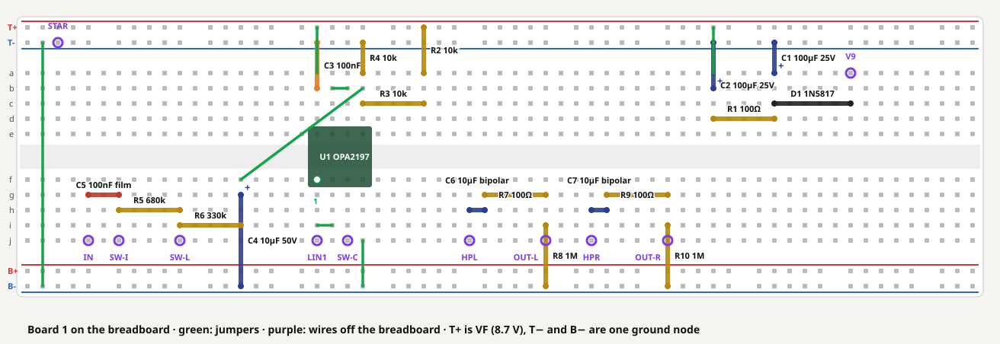

# Board 1 on the breadboard

The first half of building board 1 (the 9 V supply, the input buffer and the output stage). Prove
the circuit on the breadboard, get first sound through it, then solder it with
[build-board1.md](build-board1.md). Decided 2026-10-01: the breadboard is quick to change, and the
stripboard is then built once, as practice for the tighter enclosure board (board A). Written
2026-10-01, in the same way as [codec-bringup-2a.md](codec-bringup-2a.md): you do the hands-on work,
Claude checks readings and photos and runs the software.

**What the breadboard is for, and what it isn't.** It proves the circuit: voltages, levels, the
Inst/Line switch, and first sound through `namchaind`. It isn't for the noise measurements. Long
breadboard rows and loose leads pick up hum a soldered board won't, so Phase 2's "noise floor at
each stage" is measured on the soldered board.

**The op-amp can wait.** Everything up to stage 6 is done without it (CPC, due 4 Oct).

The placement is [breadboard/board1.py](../breadboard/board1.py). It takes its netlist from
[stripboard/board1.py](../stripboard/board1.py), so the two builds are the same circuit, and running
it checks the placement against that netlist and redraws the picture:

```bash
python3 breadboard/board1.py
```

---

## The placement



Columns 1–63, rows **a–e** above the centre channel and **f–j** below it. The five holes a–e of a
column are joined, and so are f–j. The rails: **T+** (top, red) carries the filtered supply VF,
about 8.7 V. **T−** (top, blue) and **B−** (bottom, blue) are ground, joined by one jumper at the
left. **B+** is unused.

| Part | Value | Holes | Notes |
|---|---|---|---|
| D1 | 1N5817 | anode c55, cathode c50 | Band towards column 50 |
| C1 | 100 µF 25 V | + a50, − T− | Stripe (−) into the rail |
| R1 | 100 Ω | d50–d46 | |
| C2 | 100 µF 25 V | + b46, − T− | |
| C3 | 100 nF ceramic | b20, T− | Decoupling at U1 pin 8 |
| R2 | 10 kΩ | T+, a27 | |
| R3 | 10 kΩ | c27–c23 | |
| R4 | 10 kΩ | a23, T− | |
| C4 | 10 µF 50 V | + g15, − B− | |
| U1 | OPA2197 on its adapter | pins 1–4 in f20–f23, pins 8–5 in e20–e23 | Across the channel, pin 1 at **f20** (bottom left). Stage 6 |
| C5 | 100 nF film | g5–g7 | |
| R5 | 680 kΩ | h7–h11 | |
| R6 | 330 kΩ | i11–i15 | |
| C6, C7 | 10 µF bipolar | h30–h31, h38–h39 | Either way round |
| R7, R9 | 100 Ω | g31–g35, g39–g43 | |
| R8, R10 | 1 MΩ | i35, B−; i43, B− | |

Jumpers: a20–T+, a46–T+, i20–i21, b21–b22, b23–f15, j23–B−, and T−–B− at column 2.

Wires off the breadboard: **+9V** a55, **STAR** T−, **IN** j5, **SW-I** j7, **SW-L** j11,
**SW-C** j22, **LIN1** j20, **HPL** j30, **HPR** j38, **OUT-L** j35, **OUT-R** j43. They go where
[build-board1.md](build-board1.md)'s "Off-board wires" table says.

- **Keep clear of the adapter.** Its board overhangs its pins by about 1.5 mm, so rows d–g of
  columns 19–24 stay empty apart from U1's own pins. The checker enforces this.
- **Don't cut the leads short.** Bend them to fit and leave the spare length, so the same parts can
  move to the stripboard afterwards.
- **Wire ends.** Breadboard holes take solid wire. For the jacks, switch and DC socket, solder a
  male-ended jumper lead or a short piece of solid wire onto each lug. Tinned stranded wire frays in
  the contacts.

---

## Rules

The same as [build-board1.md](build-board1.md#rules-for-the-whole-build): nothing powered while
you change anything, the Cioks outlet is centre-negative, never ground HPL/HPR/OUT3, keep the four
high-impedance input wires short, and one ground point at the star tag.

---

## Stage 1: parts and terminals

- [ ] [build-board1.md](build-board1.md) stage 1: meter-check the parts.
- [ ] [build-board1.md](build-board1.md) stage 2: find the jack, DC socket and switch lugs, and
      confirm +9 V on the DC socket's sleeve.

> **▶ Tell Claude:** the lug map and the 9 V reading.

## Stage 2: the breadboard

Use the spare breadboard. The codec board stays where it is.

- [ ] **Check the rails run the full length.** Continuity from column 1 to column 63 along each of
      the four rails. Many 830-point boards split each rail in the middle. If yours does, bridge the
      gap on T+, T− and B− with a short jumper.
- [ ] Check that T+ and T− don't beep to each other. They shouldn't on a new board.

## Stage 3: the supply

- [ ] Fit D1, C1, R1, C2 and C3, and the jumpers a46–T+ and T−–B−.
- [ ] Wire the DC socket's **sleeve** (+9 V) lug to **a55**, and its **centre** (0 V) lug to the M3
      star tag. Wire the tag to the **T−** rail.
- [ ] Cioks on. Measure against the star tag:
  - a55: about 9 V
  - column 50 (C1's +): about 0.2–0.3 V less
  - the T+ rail: the same again

> **▶ Tell Claude:** the three voltages.

## Stage 4: the bias, the input and the outputs

Cioks off.

- [ ] Fit R2, R3, R4, C4 and the jumper b23–f15. Cioks on, and measure **column 23, top half** (it
      will be U1 pin 5): expect about **2.9 V**, a third of T+. Cioks off.
- [ ] Fit the jumpers a20–T+, i20–i21, b21–b22 and j23–B−.
- [ ] Fit C5, R5, R6, C6, R7, R8, C7, R9 and R10.
- [ ] Wire the jacks, the switch and the star tag as in
      [build-board1.md](build-board1.md) stage 6: sleeves (and the outputs' rings) to the tag, the
      input jack's tip switch to its sleeve, the screened cable's screen to the jack sleeve only.

## Stage 5: check it all before the op-amp exists

Cioks on, op-amp not fitted. Measure the holes U1's pins will go into, against the star tag:

| U1 pin (hole) | Expect |
|---|---|
| 8 (e20) | about 8.7 V |
| 4 (f23) | 0 V |
| 5 (e23) | about 2.9 V |
| 3 (f22) | about 2.6 V at Inst, 2.8 V at Line (the meter's 10 MΩ loads the 1 MΩ or 330 kΩ path) |

Then, Cioks off: about **1 MΩ** from each output jack's tip to ground, and no continuity from HPL
(j30) or HPR (j38) to ground.

> **▶ Tell Claude:** the readings and a photo from above, square on. Claude checks the photo
> against the placement.

## Stage 6: the op-amp

- [ ] Solder the OPA2197 onto the adapter as in [build-board1.md](build-board1.md) stage 8.
- [ ] Cioks off. Press the adapter across the channel, **pin 1 at f20**.
- [ ] Cioks on. **f20** (pin 1) and **e21** (pin 7) both about **2.9 V**, and e20 still about 8.7 V.

> **▶ Tell Claude:** a photo of the soldered adapter before it goes in, then the three voltages.

## Stage 7: the codec, and first sound

As [build-board1.md](build-board1.md) stages 9 and 10, with the breadboard in place of the board:
LIN1 (j20) → codec LIN1, codec HPL → j30, codec HPR → j38, codec GND → the star tag, and nothing
else joining the two. Claude moves `namchaind` to the codec (asking first, and not during Phase 1's
soak). Amp volume low, guitar in at Inst, play, then try Line.

If something needs changing, change it here and tell Claude. The layout files are updated before
anything is soldered.

---

## Results

| What | Value | Date |
|---|---|---|
| Rails split in the middle? | | |
| +9V / C1 / T+ | | |
| Bias (e23) | | |
| Pin 3 hole (f22), Inst / Line | | |
| Op-amp outputs (f20 / e21) | | |
| First sound | | |
| Changes for the soldered board | | |
