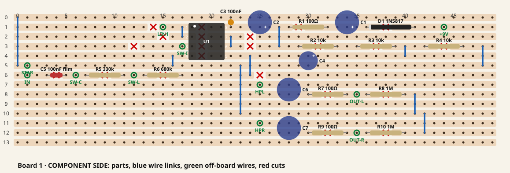
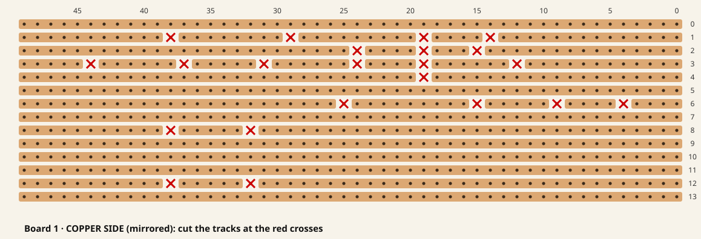
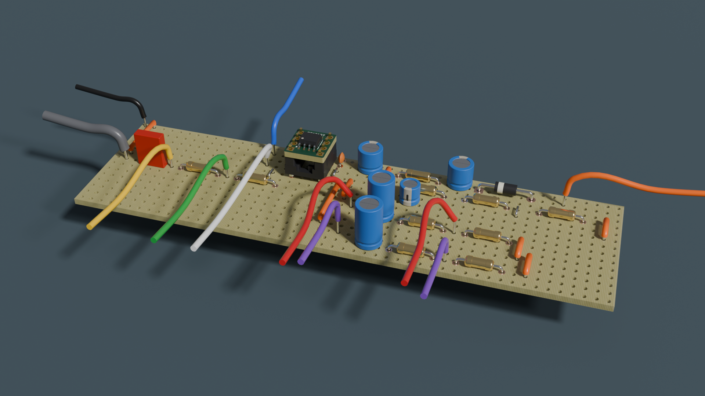

# Board 1: the 9 V supply, the input buffer and the output stage

A walkthrough of [plan.md](../plan.md) Phase 2b step 3, for you to follow at the bench, in the same
way as [codec-bringup-2a.md](codec-bringup-2a.md). You do the hands-on work. Claude checks readings
and photos, and runs the software on the Core host. Written 2026-09-30.

**How to use it.** Work through the stages in order and tick the boxes. Each **▶ Tell Claude** marks
where to stop and paste readings or a photo. If anything looks, smells or measures wrong, unplug and
ask.

**Order (decided 2026-10-01):** the circuit goes on the breadboard first
([build-board1-breadboard.md](build-board1-breadboard.md)), and this soldered build follows once
it has worked there. The stripboard is also practice for the enclosure's tighter board A. Phase 2's
noise measurements are made on this board, not the breadboard.

**What board 1 delivers.** Guitar → input jack → buffer → the codec board's LIN1, and the codec's
HPL/HPR → output stage → OUT L and OUT R, powered from a Cioks outlet. With `namchaind` on the codec,
that's Phase 2's "done when": guitar → buffer → WM8960 → `namchaind` → output stage → amp.

**The op-amp can wait.** It's the only part still due (CPC, 4 Oct). It sits in a socket, so everything
up to stage 8 is done without it, and stage 7 checks every socket pin's voltage before it goes in.

The circuit is the one in [bom.md](bom.md) ("The input stage these parts make" and "Analogue
output"). The layout is [stripboard/board1.py](../stripboard/board1.py). Running it checks the layout
against the netlist and redraws both pictures below:

```bash
python3 stripboard/board1.py
```

---

## The layout

Component side, as you'll see it while fitting parts. Holes are numbered from the top-left: **x**
along the strips (0–49), **y** across them (rows 0–13). Board 1 uses the top-left 50 × 14 holes of
the Kemo board and leaves the rest free. The codec board and, later, the bypass relay can go there.



Copper side, **mirrored**, which is what you see when you turn the board over to cut the tracks. Row
numbers stay the same. Column 0 is now on the right.



- **Red crosses:** 22 track cuts. **Blue lines:** 11 wire links on the component side. **Green
  rings:** 11 holes where a wire leaves the board.
- **U1** is the 8-pin DIL socket. Pin 1 is top-left, at (18, 1). The white dot marks it. Fit the
  socket with its notch towards that end.
- Nets, for reading the pictures: row 0, row 5 and row 10 are ground. Row 1 carries the supply
  (+9 V in → D1 → R1 → the filtered 8.7 V, called VF). Row 4 to the right of U1 is the 2.9 V bias
  (VB). Rows 6–8 and 11–12 are signal.

### What goes where

| Part | Value | Holes | Notes |
|---|---|---|---|
| D1 | 1N5817 | anode (41, 1), cathode (36, 1) | Band towards the left (x 36). Reverse-polarity protection |
| C1 | 100 µF 25 V | + (34, 1), − (34, 0) | Stripe (−) on row 0 |
| R1 | 100 Ω | (32, 1)–(28, 1) | With C2, filters the op-amp's supply |
| C2 | 100 µF 25 V | + (25, 1), − (25, 0) | Stripe on row 0 |
| C3 | 100 nF ceramic | (22, 1)–(22, 0) | Decoupling at U1 pin 8 |
| R2, R3 | 10 kΩ each | (29, 3)–(33, 3), (35, 3)–(39, 3) | The bias divider's top |
| R4 | 10 kΩ | (42, 3)–(46, 3) | The bias divider's bottom |
| C4 | 10 µF 50 V | + (30, 4), − (30, 5) | Stripe on row 5 |
| U1 | 8-pin DIL socket | pins 1–4 at x 18, rows 1–4; pins 8–5 at x 21, rows 1–4 | The OPA2197 on its adapter plugs in here (stage 8) |
| C5 | 100 nF film | (3, 6)–(5, 6) | Input coupling. Film, not ceramic, no polarity |
| R5 | **680 kΩ** | (7, 6)–(11, 6) | The Line pad's top: node A to node B |
| R6 | **330 kΩ** | (13, 6)–(17, 6) | The Line pad's bottom, to the bias: node B to the bias |
| C6, C7 | 10 µF bipolar | (28, 7)–(28, 8), (28, 11)–(28, 12) | Output coupling. Bipolar: either way round |
| R7, R9 | 100 Ω | (30, 8)–(34, 8), (30, 12)–(34, 12) | Output series resistors |
| R8, R10 | 1 MΩ | (36, 8)–(40, 8), (36, 12)–(40, 12) | Output bleeds, which hold the jacks at 0 V DC |

Links: (17, 1)–(17, 2), (22, 2)–(22, 3), (27, 1)–(27, 3), (40, 3)–(40, 4), (48, 3)–(48, 5), (16, 4)–(16, 5), (24, 6)–(24, 4), (0, 0)–(0, 5), (23, 5)–(23, 10), (41, 8)–(41, 10), (42, 12)–(42, 10).

Cuts: (4, 6), (9, 6), (12, 3), (14, 1), (15, 2), (15, 6), (19, 1), (19, 2), (19, 3), (19, 4), (24, 2), (24, 3), (25, 6), (29, 1), (31, 3), (32, 8), (32, 12), (37, 3), (38, 1), (38, 8), (38, 12), (44, 3).

### Off-board wires

| Pad | Hole | Goes to |
|---|---|---|
| V9 | (44, 1) | The DC socket's +9 V contact (stage 2 finds which) |
| STAR | (1, 5) | The star-ground tag |
| IN | (1, 6) | Input jack tip, through the screened cable's core |
| SW-I | (6, 6) | Inst/Line switch, the Inst throw: node A, past C5 |
| SW-L | (12, 6) | Inst/Line switch, the Line throw: node B, between R5 and R6 |
| SW-C | (17, 3) | Inst/Line switch, the common (middle) lug: the follower's input, U1.3 |
| LIN1 | (15, 1) | Codec board LIN1 (right-hand row) |
| HPL | (25, 7) | Codec board HPL |
| HPR | (25, 11) | Codec board HPR |
| OUT-L | (35, 8) | OUT L jack tip |
| OUT-R | (35, 12) | OUT R jack tip |

### What it looks like built

Rendered from `stripboard/board1.blend`, which is built from the same layout file (it isn't in git;
make it with `make_parts.py board1` in KiCad's Python, then
`blender -b --factory-startup -P enclosure/src/build_board1.py` from `enclosure/`). The flying
leads are drawn short and in arbitrary colours.



More views: [plan](../stripboard/renders/board1-plan.png), [low](../stripboard/renders/board1-low.png),
[copper side](../stripboard/renders/board1-copper.png).

---

## Rules for the whole build

1. **Nothing powered while you solder or rewire.** Unplug the Cioks lead from the board, and unplug
   piv before touching the codec board's leads (2a's rule: a Pi's 5 V header pin stays live after
   `poweroff`).
2. **The Cioks outlet is centre-negative.** On the DC socket, the centre pin is 0 V and the outer
   sleeve is **+9 V**. Stage 2 confirms it with the meter. It matters again in Phase 4: the socket's
   sleeve must not touch a metal panel.
3. **Never ground HPL, HPR or OUT3.** They sit at about 1.65 V DC (2a's rule). HPL and HPR only
   ever reach a jack through C6/C7. Never plug an output into a **phantom-powered** input either:
   48 V arrives on the tip through that input's 6.8 kΩ feed resistors, and stands across C6/C7 the
   wrong way round. Check the interface's switch before its cable goes in.
4. **The input nodes are high impedance** (about 1 MΩ). The IN, SW-I, SW-L and SW-C wires pick up
   hum like an antenna. Keep them short, run them close to the board, and twist SW-I, SW-L and SW-C
   loosely together.
5. **One ground point.** Every ground meets at the star tag (stage 6). piv's ground reaches it only
   through the codec board's header GND. That's the 2b finding: sharing ground with the SSL through
   piv put a 90 Hz comb 7 dB above the codec's floor.

---

## Stage 1: check the parts

- [ ] Lay out board 1's parts (the table above), and check each resistor with the meter before it
      goes in. The colour bands on 1% resistors are easy to misread. Expected readings: 100 Ω,
      10 kΩ, 330 kΩ, 680 kΩ, 1 MΩ.
- [ ] Also on the bench: the Kemo board, the 8-pin DIL socket (not the 6-pin ones, which are for
      the MIDI optocoupler), three Neutrik NMJ6HF-S jacks (IN, OUT L, OUT R), the DC socket, the
      toggle switch, an M3 solder tag, the screened cable, and hook-up wire.
- [ ] Polarity. The electrolytics C1, C2 and C4 have a stripe on the **−** side. The bipolar C6
      and C7 go either way round. D1's band is its **cathode**.

## Stage 2: find the terminals with the meter

Nothing is powered yet, except for the last check.

- [ ] **Each jack** (IN, OUT L, OUT R). Six lugs, in two rows of three: **T**, **R**, **S** along the
      body (**S** nearest the opening), and **TN**, **RN**, **SN** opposite them. Push a jack plug in
      and find which lug beeps to the plug's tip, ring and sleeve. **All three** contacts are
      switched, so each switch beeps to its own contact **only with no plug in** — **TN**–**T**,
      **RN**–**R**, **SN**–**S** — and all three go open when the plug goes in. Note all six for one
      jack; the other two are the same. Neutrik's chart is
      [jacks-circuits.pdf](../references/neutrik-nmj6hf-s/jacks-circuits.pdf), with the datasheet
      and the mechanical drawing beside it.
- [ ] **The DC socket.** Plug the Cioks lead in with the Cioks switched off. Find which lug beeps to
      the centre pin and which to the sleeve. If there's a third lug, note whether it beeps to the
      sleeve only with no plug in.
- [ ] **The toggle.** Find the common lug (usually the middle one). Note which outer lug it connects
      to in each position.
- [ ] Switch the Cioks on and measure DC volts between the socket's lugs: expect **+9 V on the
      sleeve lug**, measured against the centre lug. Switch it off again.

> **▶ Tell Claude:** the lug map for a jack, the DC socket and the switch, and the 9 V reading.

## Stage 3: cut the tracks

- [ ] Turn the board so the strips run left to right, copper down. Mark the component side's
      top-left hole as (0, 0) with a pen. That's where the STAR wire goes.
- [ ] Turn it copper side up. Now (0, 0) is at the **top right**. Work from the copper-side picture.
- [ ] Cut the 22 holes with a spot-face cutter or a 3–4 mm drill bit turned by hand. Count holes
      from the nearest numbered column each time, not from the last cut. Every cut must go right
      across the strip. Check the copper at that hole is gone, not just scratched.
- [ ] Check each cut with the meter's continuity: the holes either side of it must **not** beep.
- [ ] Check that no adjacent strips are bridged by swarf. Brush the board, then check with the
      meter between neighbouring rows at a few places along the board.

> **▶ Tell Claude:** a photo of the copper side, square on and in good light. Claude checks every
> cut against the layout.

## Stage 4: links and the socket

Lowest parts first, so the board sits flat while you solder.

- [ ] The 11 wire links. Use insulated hook-up wire for the long ones: (1, 0)–(1, 5),
      (23, 5)–(23, 10), (24, 6)–(24, 4), (27, 1)–(27, 3), (41, 8)–(41, 10), (42, 12)–(42, 10) and
      (48, 3)–(48, 5). The short ones can be bare leads cut from resistors.
- [ ] The 8-pin DIL socket, notch towards the left: pin 1 at (18, 1).

## Stage 5: build and test the supply

- [ ] Fit D1, R1, C1, C2 and C3.
- [ ] Wire the DC socket: the **sleeve** (+9 V) lug to the **+9V** pad, and the **centre** (0 V)
      lug to the M3 star tag. Wire the board's **STAR** pad to the same tag.
- [ ] Before powering it: resistance from the +9V pad to STAR. It should climb as C1 and C2 charge
      through the meter, not sit near 0 Ω.
- [ ] Switch the Cioks on. Measure DC volts against the star tag:
  - the +9V pad: about 9 V (whatever the outlet gives)
  - the V9 strip, C1's + lead: about 0.2–0.3 V less (D1's drop)
  - U1 socket **pin 8**, at (21, 1): the same again. With nothing drawing current yet, R1 drops
    almost nothing.

> **▶ Tell Claude:** the three voltages.

## Stage 6: the bias, the input and the outputs

Cioks off.

- [ ] Fit R2, R3, R4 and C4. Power on and measure U1 socket **pin 5**, at (21, 4): expect about
      **VF ÷ 3, about 2.9 V**. Power off.
- [ ] Fit C5, R5, R6, C6, R7, R8, C7, R9 and R10.
- [ ] **Star ground.** Wire to the tag, each on its own wire: the input jack's sleeve lug, and each
      output jack's sleeve **and** ring lugs (ring to ground on the outputs, as in the BOM). The DC
      socket's 0 V and the board's STAR are already there. The codec board's GND joins in stage 7.
- [ ] **Input jack.** Screened cable from the jack to the board. The core goes from the tip lug to
      **IN**. The screen goes to the jack's sleeve lug only, and is left unconnected at the board
      end. Also wire the jack's **tip switch** lug to its sleeve lug, so an empty jack holds the
      input at 0 V.
- [ ] **Inst/Line switch.** Common (the middle lug) → **SW-C**, which is the follower's input
      and so the wire that also reaches U1.3. The throw the lever selects at **Inst** → **SW-I**
      (node A, past C5), and the other → **SW-L** (node B, between R5 and R6). Keep these three
      wires short. The two throws' wires are the same node in two places, so the *meter* is what
      tells them apart: at Inst the middle lug beeps to the SW-I wire.
- [ ] **Output jacks.** OUT-L pad → OUT L tip lug. OUT-R pad → OUT R tip lug. Leave these wires long
      enough to reroute later: Phase 3.6's bypass relay goes between the board and these tips.

## Stage 7: check it all before the op-amp exists

Cioks on, op-amp **not** fitted. Measure the socket's pins against the star tag:

| U1 pin | Expect | Why |
|---|---|---|
| 8 | about 8.7 V | VF |
| 4 | 0 V | ground |
| 5 | about 2.9 V | the bias, straight from the divider |
| 3 | **the lower of the two positions, always.** The meter loads the node it is on: at Inst it sits on node A and reads `Vbias × Rm/(Rm + 1.01 MΩ)`; at Line it sits on node B and reads `Vbias × Rm/(Rm + R6)`, Rm being the meter's own input resistance — a cheap DMM's DC volts range is typically 1 MΩ, a bench meter's 10 MΩ. Worked with Vbias = 2.95 V: **Rm = 1 MΩ → Inst ≈ 1.50 V, Line ≈ 2.24 V**; **Rm = 10 MΩ → Inst ≈ 2.67 V, Line ≈ 2.86 V** | the ohms range, power off, is the test that settles it: **pin 3 to the bias hole (21, 4) reads 1.01 MΩ at Inst and 330 kΩ at Line**, and the toggle's middle lug beeps to the SW-I wire at (6, 6) at Inst. `Rm` can be worked out from the two volts readings: `Rm = 1.01 MΩ × V_Inst/(Vbias − V_Inst)`. The **−9.7 dB** pad is an *audio* figure: no DC voltmeter shows it, and these readings only say which position the toggle is in and how much the meter itself is loading |
| 1, 2, 6, 7 | anything, or drifting | nothing drives them yet |

Then, Cioks off:

- [ ] Resistance from the OUT L jack's tip to ground: about **1 MΩ** (R8). The same for OUT R.
- [ ] No continuity from HPL or HPR to ground. They go only into C6 and C7.

> **▶ Tell Claude:** the table's readings and a photo of the component side. Claude checks the
> photo against the layout.

## Stage 8: the op-amp (when it arrives)

The OPA2197 is SOIC-8, at 1.27 mm pitch. It goes onto the Aries adapter, and the adapter goes into the
socket.

- [ ] Find pin 1 on the chip (a dot or a bevelled edge) and on the adapter (usually marked on its
      pads).
- [ ] Flux on the adapter's pads. Tin **one** corner pad lightly, place the chip, reflow that one
      joint, and check under a magnifier (or a phone camera) that all eight legs sit on their pads.
      Only then solder the diagonally opposite corner, then the rest. A fine tip and a little solder:
      if two pins bridge, flux and braid clear it.
- [ ] Check with the meter that no two neighbouring pins beep to each other.
- [ ] **Cioks off.** Plug the adapter in, pin 1 to the socket's pin 1 at (18, 1).
- [ ] Cioks on. Measure: **pin 1** (the buffer's output) and **pin 7** (the unused half) both about
      **2.9 V**, and pin 8 still about 8.7 V. If either output sits near 0 V or near 8.7 V, switch
      off and tell Claude.

> **▶ Tell Claude:** a photo of the soldered adapter before it goes in, then the three voltages.

## Stage 9: connect the codec board

piv unplugged. The codec board stays on its jumper leads to piv's header, wired as in 2a (VIN from
piv's 5 V, stock). Remove 2a's breadboard fixture and socket A from the codec board first.

- [ ] Board **LIN1** pad → codec **LIN1** (right-hand row).
- [ ] Codec **HPL** → board **HPL** pad. Codec **HPR** → board **HPR** pad.
- [ ] Codec **GND** (right-hand row) → the star tag. That is the only ground wire between the codec
      board and board 1.
- [ ] Check: no other wire joins board 1 or the jacks to piv. No SSL connected.

> **▶ Tell Claude:** a photo of both boards and the star tag. Don't power up until Claude has
> looked.

## Stage 10: first sound, then the measurements

Claude moves `namchaind` from the SSL 2+ to the codec on piv. That needs the Core host's lock, and
not during Phase 1's soak, so Claude checks the lock and asks first.

- [ ] Amp volume **low**. The codec's output is about 1 V rms at full scale, which is hot for a
      guitar amp's input. Start the rig's output level low as well.
- [ ] Guitar → IN, switch at **Inst**. OUT L → amp. Play.
- [ ] Try **Line** with the guitar: it should drop about 10 dB.
- [ ] Listen with the guitar's volume at 0: hum, buzz or hiss. Then touch the guitar's strings.
      The hum should drop, not rise.

Then Claude records what Phase 2 is done on:
- The noise floor at each stage: the codec's input with board 1 connected and the jack empty, then
  with the guitar plugged in, and at the outputs. Measured through the SSL, with care about its
  ground (2a's 90 Hz comb).
- An hour on the codec, clean.

---

## If something goes wrong

| Symptom | Likely cause |
|---|---|
| No 9 V on the board | DC socket lugs swapped, so D1 is blocking. That's what it's for. Recheck stage 2 |
| VF much lower than V9 | Something draws current: a short on row 1, or C2/C3 fitted into the wrong holes |
| Bias far from 2.9 V | A missed cut on row 3 (at 31, 37 or 44), or R2–R4 in the wrong holes |
| Pin 3 at 0 V | A missed cut at (4, 6) or (9, 6), the switch wiring, or the input jack's tip switch wired to the tip instead of the sleeve |
| Output pin at a rail | The follower link (17, 1)–(17, 2) missing, or the chip turned round on the adapter |
| Hum that stops when you touch the strings | Normal for single coils. Check that it drops |
| Hum that doesn't change | A second ground path: the SSL, a lead to piv, or the screen connected at both ends |
| Crackle when the switch moves | Normal while the lever is between positions. It shouldn't happen at rest |

## Results

| What | Value | Date |
|---|---|---|
| Jack lug map | | |
| DC socket: +9 V lug | | |
| +9V pad / V9 / VF | | |
| Bias (pin 5) | | |
| Pin 3 (Inst / Line) | | |
| Outputs to ground | | |
| Op-amp outputs (pin 1 / pin 7) | | |
| First sound | | |
| Noise floor, per stage | | |
| Hour on the codec | | |
