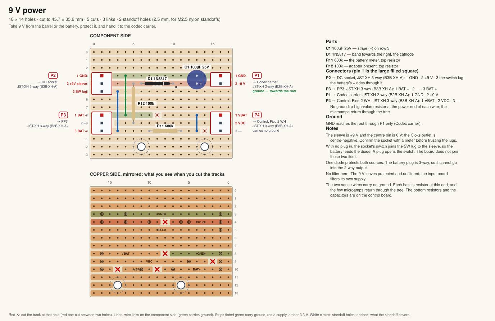
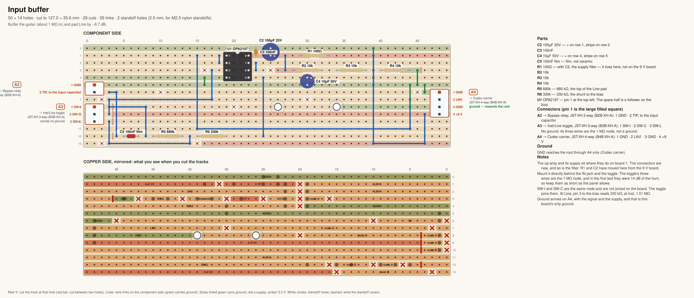
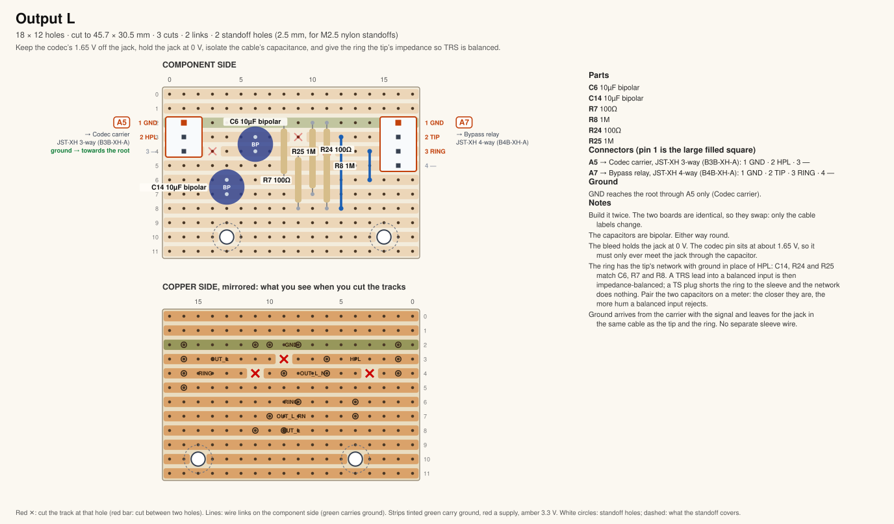
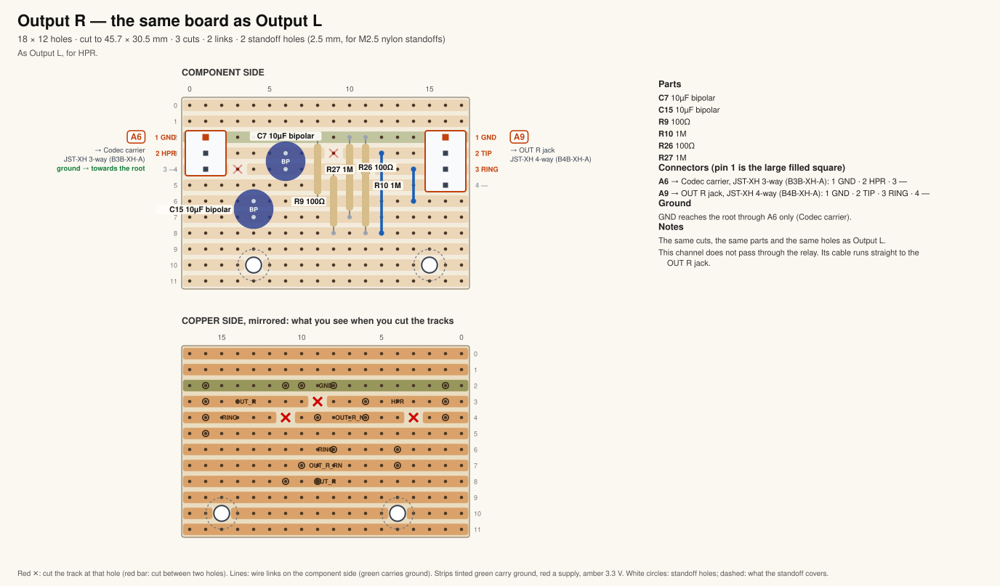
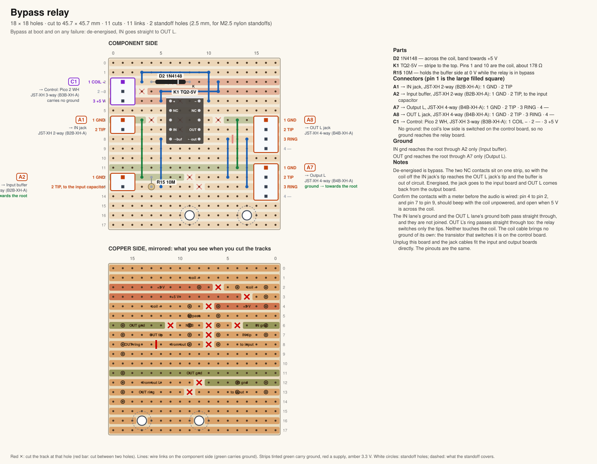
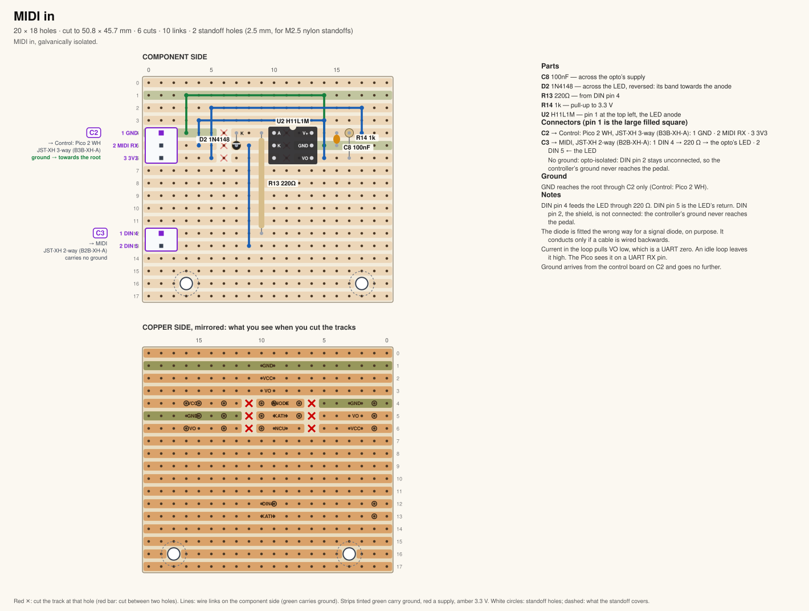
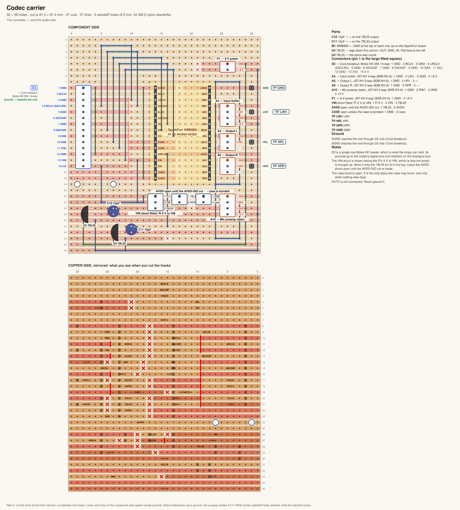
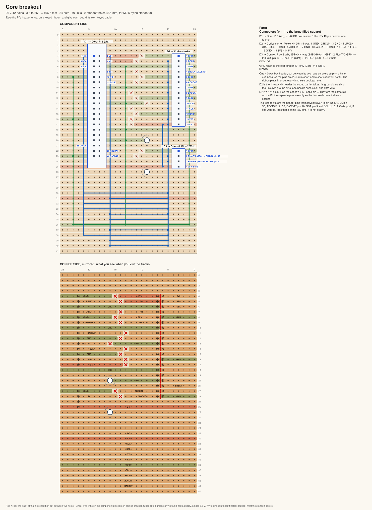
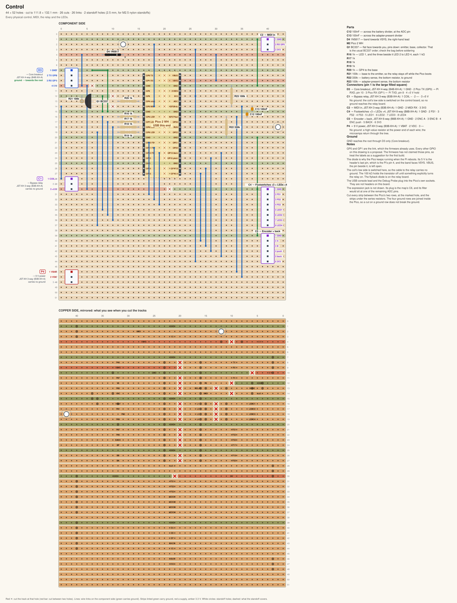

# Stripboard sketches of the modules

Written 2026-10-12. These are first layouts to build from, not a packed design. Each one is
checked against [diagrams/modules.html](diagrams/modules.html) — the pinout and the ground tree
live there, and this page does not repeat them — and against the netlist in
`stripboard/nets.py` where the board carries that circuit. Regenerate the drawings from the
`pedal.project` root with `python3 stripboard/module_boards.py`. The layouts are the data in
`stripboard/module_boards.py`.

Every connector is the map's: JST XH in the main, a Molex KK 254 where the map says a 14-way
(D2, too many ways for XH in a 2.54 mm grid), and a 2×20 box header for the Pi. Pin 1 is the
large filled square. XH is a 2.50 mm pitch in 2.54 mm holes, which is fine at these pin counts.
A cable that carries a supply has a different number of ways from a signal cable, so the two
plugs cannot swap. Two 2.5 mm holes on each board are for M2.5 nylon standoffs. The copper
drawing is mirrored: it is the board as you see it while cutting.

Ground follows the map. One cable on each board runs towards the Pi, and that cable is the
board's only ground arrival. The relay coil (C1), the MIDI DIN (C3), the battery sense (P4)
and the input toggle (A3) carry no ground. The relay keeps the input lane's ground and the
output lane's ground apart. On the codec carrier the analogue ground and the digital ground
meet only inside the WM8960.

Not drawn, because there is no circuit for them yet: the mic preamp, the isolated 9 V
supply, and the Qwiic port. The carrier still has the A10 socket the mic preamp would plug
into, and the breakout's I2C pins are where a Qwiic port would tap. The Pi, the display and
the panel parts are not boards of their own.

## 9 V power

45.7 × 35.6 mm. Ground arrives on P1, the cable to the codec carrier, and leaves on P2 and P3
towards the socket. P4, the battery sense, has no ground pin: each sense wire has its resistor
at this end, and the return is the ground tree. The socket's sleeve and its switch lug are not
joined on the board. Sleeve is the barrel's +9 V, the centre pin is ground, and the switch lug
is the battery, which the socket itself connects only while the barrel is out.

## Input buffer

127.0 × 35.6 mm. It is the input half of board 1, with the connectors added, rather than a
shortened layout. Ground arrives on A4, the cable to the codec carrier. A3, the toggle, has
no ground: its three wires are the two pads and the wiper, and the board does not join the
pads. The supply filter that used to sit on the power board (100 Ω, 100 µF, 100 nF) is here,
beside the op-amp.

## Output, left and right

One design, built twice. 45.7 × 30.5 mm. Output L takes HPL from the carrier on A5 and sends
the jack tip and ring to the relay on A7. Output R takes HPR on A6 and sends them straight to
the jack on A9; it does not pass through the relay. Ground arrives from the carrier. The tip's
capacitor is bipolar, and it is what keeps the codec's 1.65 V off the jack.

The ring has the same three parts with ground in place of HPL, so the jack is
impedance-balanced on a TRS lead and plain unbalanced on a TS one
([balanced-outputs.md](balanced-outputs.md), step 1, decided 2026-10-14). Pair the two 10 µF
capacitors on a meter: the closer they match, the more hum a balanced input rejects. The jack
cable is four-way (GND, tip, ring, unused), so it cannot go into the board's three-way HPL
socket or the relay's coil socket.

## Bypass relay

45.7 × 45.7 mm. Two grounds, kept apart: the input lane arrives on A2, from the input board,
and the output lane arrives on A7, from output L. Neither touches the coil. OUT L's ring passes
straight from A7 to A8; the relay switches only the tips. C1, from the
control board, is the coil pair and has no ground. De-energised is bypass.

Confirm the relay with a meter before wiring audio. The drawing uses the component-side view
of a TQ2-5V: pin 1 at the top of the left column. Unpowered, pin 4 should beep to pin 2, and
pin 7 to pin 9. With 5 V across the coil those should open. The datasheet's own drawing is the
bottom view, the mirror of this one.

## MIDI in

50.8 × 45.7 mm. Ground arrives on C2, from the control board, and stops there. C3, to the DIN
socket, has no ground: the opto-isolator's LED is all that the socket drives, and the
pedal's ground never reaches it. The diode across the LED is fitted the wrong way for a signal
diode, on purpose.

## Codec carrier

81.3 × 91.4 mm. This is the audio star. Analogue ground is the bus on the header side of the
codec; digital ground is the bus on D2. They meet through the WM8960's own ground pins and
nowhere else on the copper. D2, from the breakout, is the root-ward cable. It is a single-row
KK 254, which is what the map allows on stripboard in place of a 14-way box header.

D2's last pin is the Pi's 5 V, pin 2. On this board that wire is named VIN, because the shunt
is drawn fitted and joins it to the codec's VIN pin. Leave the AVDD shunt open until the
AVDD-ISO cut is made. Leave the case jumper open: that bond is the one place the case may
touch the star. OUT3 is not connected.

## Core breakout

66.0 × 106.7 mm. Ground arrives on D1, the Pi's own 40-pin header, and leaves on D2 to the
codec carrier and on D3 to the Pico. D1 is a 2×20 box header. Cut between its two rows with a
knife: the pins are 2.54 mm apart, so a spot cutter will not fit, and the ribbon plugs in once.
The test points are the header pins themselves (BCLK is pin 12, LRCLK pin 35, ADCDAT pin 38,
DACDAT pin 40, SDA pin 3, SCL pin 5). A Qwiic port, if it is wanted later, taps those same I2C
pins; it is not drawn.

D2's last pin is the same 5 V wire the carrier calls VIN. Here it is still the Pi's pin 2.

## Control

111.8 × 132.1 mm. The Pico 2 WH sits in socket strips, USB at the top. Ground arrives on D3,
from the breakout, and leaves on the looms. C1, the relay coil, has no ground: the transistor
switches the low side. P4, the battery sense, has no ground either. The 1N5817 into VSYS is
why the Pico stays up when the Pi reboots; VBUS is left open. The USB console lead and the
Debug Probe plug into the Pico's own sockets, so they are not headers here.

GP0 and GP1 are the link, which the firmware already uses. Every other GPIO label on this
drawing is a proposal. The firmware has not claimed those pins. The expression jack (the map's
C6) is not drawn.
